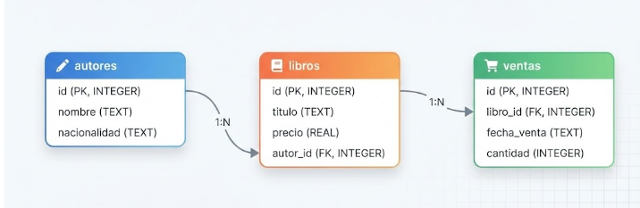

# PactR

Este proyecto es un template o plantilla que debe adaptarse a las condiciones especificas de los datos de entrada de la solución. `validacion-entrada` tiene como objetivo la generación de pruebas automáticas sobre los datos de entrada para una solución de datos desplegadas. Utiliza un modelo de lenguaje, a través de un gateway compatible con la API de OpenAI, para leer un contrato de datos en formato Markdown, generar pruebas unitarias basadas en `testthat`, y luego ejecutarlas de forma reproducible contra la base de datos activa.

---

## Demo ejemplo

Para demostrar como funciona este reporte, utilizamos una base de datos
en memoria RSQLite que se puede recrear corriendo el script en la
carpeta `data`. El contrato de datos para este ejemplo, se encuentra en la carpeta `contrato`. 
El ejemplo es de una base de datos de ventas de una minilibreria. El diagrama de la base de datos es el siguiente:




## Piezas Fundamentales del Proyecto

*   **Contrato de Datos (`contrato/`):** Documento en Markdown que especifica la estructura y reglas de las tablas (ej. `### Tabla: NOMBRE_TABLA`). Sirve como la fuente de verdad única para la validación.
*   **Pruebas Unitarias (`tests/`):** Código de prueba generado automáticamente por el LLM. Se crea un archivo por cada tabla detectada en el contrato (ej. `test_contrato_<tabla>.R`).
*   **Prompts (`prompts/`):** Los textos que recibe el LLM, en archivos separados para poder ajustar su redacción sin tocar código R. `system_prompt.md` instruye detalladamente sobre cómo escribir los tests de `testthat` adaptados para R; `instrucciones_pruebas.md` añade las reglas de robustez y el patrón obligatorio de validación de esquema; `db_<motor>.md` describe el motor de base de datos en uso; y `prompt_tabla.md` es el prompt que se envía por cada tabla del contrato.
*   **Plantillas (`plantillas/`):** El contenido de los archivos que el generador escribe y que no dependen del LLM: `helpers_base.R`, `helpers_<motor>.R` y `helpers_generico.R` (que se concatenan para formar `tests/helpers.R`), `run_tests.R` y `test_cobertura_contrato.R`. Son código R real, de modo que el editor los formatea y revisa; los marcadores `{{clave}}` se sustituyen al generar.
*   **Código R (`r/`):**
    *   `validar_contrato.R`: Punto de entrada. Orquesta el flujo completo y carga los demás módulos.
    *   `config.R`: Constantes y parámetros de configuración del entorno de ejecución (rutas de archivos, modelo LLM, etc.), leídos del `.Renviron`.
    *   `parsear_contrato.R`: Deriva del contrato, sin LLM, la lista de reglas que las pruebas deben cubrir, cada una con un identificador canónico `tabla.columna.regla`.
    *   `verificar_cobertura.R`: Compara esas reglas contra las pruebas realmente generadas y falla si alguna quedó sin cubrir.
    *   `cliente_llm.R`: Llamadas al servidor del LLM en modo streaming, con reintentos, y extracción del código R de la respuesta.
    *   `prompts.R`: Construcción del system prompt y del prompt de cada tabla a partir de `prompts/`.
    *   `plantillas.R`: Escritura de `tests/helpers.R`, `run_tests.R` y la meta-prueba de cobertura a partir de `plantillas/`.
    *   `generar_pruebas.R`: Flujo de generación tabla por tabla. Un fallo en una tabla no detiene a las demás.
    *   `conexion.R`: Contiene la función `conecta_me()` para gestionar de forma segura la conexión a la base de datos SQL Server utilizando el driver ODBC.

---

## Variables de Entorno (`.Renviron` / `.env`)

Crea un archivo `.Renviron` en la raíz del proyecto (para ejecución en R) y un archivo `.env` (para ejecución con Docker) con las siguientes variables obligatorias:

```env
# Conexión a Base de Datos o Fuente de datos
USUARIO_DB=tu_usuario
CONTRASENA_DB=tu_contraseña
SERVIDOR=dirección_del_servidor
BASE_DE_DATOS=nombre_base_datos
# Solo para DB_TYPE=postgres. Si se omite, se asume 5432
PUERTO_DB=5432

# Servidor del LLM para generación de tests (API compatible con OpenAI)
LLM_BASE_URL=https://api.openai.com/v1
LLM_API_KEY=tu_api_key
LLM_MODEL=nombre_del_modelo
# Opcional: false si el proveedor no soporta streaming (por defecto true)
#LLM_STREAM=true

# Rutas del generador, relativas a la raíz del proyecto
CONTRACT_FILE_PATH=contrato/contrato_datos.md
SYSTEM_PROMPT_PATH=prompts/system_prompt.md
TEST_OUTPUT_DIR=tests
DB_TYPE=sqlite

# Directorio o bucket en donde se escribirán los resultados de las pruebas (.parquet)
TEST_RESULTS_DIR=/ruta/hacia/directorio/de/resultados
```

---

## Uso y Flujo de Trabajo

Este proyecto utiliza **rv** (no renv) para la gestión reproducible del entorno de R, declarando dependencias en `rproject.toml` y fijándolas en `rv.lock`.

### 1. Preparación del Entorno
Antes de comenzar, restaura o sincroniza todas las dependencias del proyecto:
```bash
rv sync
```

### 2. Ejecución Local (Paso a Paso)

Para generar y ejecutar las pruebas de validación localmente, abre R en la raíz del proyecto y corre los siguientes pasos:

*   **Paso 1: Generar las pruebas desde el contrato** (requiere `LLM_BASE_URL`, `LLM_API_KEY` y `LLM_MODEL` configurados):
    ```r
    source("r/validar_contrato.R")
    ```
    *Esto leerá el contrato, se comunicará con el LLM y escribirá los archivos de pruebas en `tests/`, el script `tests/helpers.R` y el script `run_tests.R` en la raíz.*

*   **Paso 2: Ejecutar los tests generados contra la base de datos**:
    ```r
    source("run_tests.R")
    ```
    *Este script ejecutará los tests de `testthat` y guardará los resultados detallados de la corrida como un archivo `.parquet` en la ruta especificada por `TEST_RESULTS_DIR`.*

---

## Ejecución con Docker

El repositorio incluye un `Dockerfile` cuyo punto de entrada es
`r/validar_contrato.R`: **genera** las pruebas a partir del contrato y verifica su
cobertura. No las ejecuta ni abre la base de datos, porque generar y ejecutar
tienen cadencias distintas (el generador corre cuando cambia el contrato; las
pruebas, de forma periódica) y necesitan secretos distintos: el generador usa la
clave del LLM y no toca la base de datos, mientras que `run_tests.R` necesita las
credenciales de la base y ninguna clave de LLM.

> La imagen de ejecución periódica (`Dockerfile.run`) todavía no existe en el
> repositorio.

### 1. Configuración

Copia `.env.example` a `.env` y rellena los valores:

```bash
cp .env.example .env
```

**No uses comillas en el `.env`.** A diferencia del `.Renviron` de R, el
`--env-file` de Docker no las interpreta: `CONTRACT_FILE_PATH="contrato/x.md"`
llegaría al contenedor con las comillas incluidas y la ruta no existiría. Por eso
el `.Renviron` no sirve directamente como `--env-file`.

El generador necesita `LLM_BASE_URL`, `LLM_API_KEY`, `LLM_MODEL` (y opcionalmente `LLM_STREAM`), `DB_TYPE`,
`BASE_DE_DATOS`, `CONTRACT_FILE_PATH`, `SYSTEM_PROMPT_PATH` y `TEST_OUTPUT_DIR`.

### 2. Construir la imagen

```bash
docker build -t validacion-entrada .
```

La construcción sincroniza las dependencias con `rv` a partir de `rv.lock`, así
que la imagen queda fijada a las mismas versiones que el entorno local.

### 3. Generar las pruebas

Las pruebas se escriben dentro del contenedor, así que hay que montar un volumen
sobre `/app/tests` para conservarlas:

```bash
mkdir -p salida_pruebas
docker run --rm --env-file .env \
  -v "$PWD/salida_pruebas:/app/tests" \
  validacion-entrada
```

Al terminar, `salida_pruebas/` contiene un `test_contrato_<tabla>.R` por tabla,
el `helpers.R` correspondiente al motor configurado y la meta-prueba
`test_cobertura_contrato.R`. El proceso falla con error si alguna regla del
contrato se quedó sin prueba.

El contenedor corre como usuario sin privilegios con UID 1000. Si tu usuario del
host tiene otro UID y el volumen queda sin permisos, ejecuta con
`--user "$(id -u):$(id -g)"`.

### Compatibilidad por motor de base de datos

| `DB_TYPE` | Genera las pruebas | Puede ejecutarlas |
| :--- | :--- | :--- |
| `sqlite` | Sí | Sí (`RSQLite`) |
| `postgres` | Sí | Sí (`RPostgres` + `libpq5` incluidos) |
| `sql_server` | Sí | **No**: falta el paquete `odbc` y el driver ODBC |

Con `DB_TYPE=sql_server` la generación funciona, pero el `helpers.R` resultante
no se puede cargar en esta imagen: `odbc` no está declarado en `rproject.toml` y
tampoco están instalados `unixodbc` ni el «ODBC Driver 17 for SQL Server».
Habilitarlo requiere añadir `odbc` a las dependencias del proyecto e instalar el
repositorio de Microsoft en el `Dockerfile`.

---

## Sobre los Resultados de las Pruebas

Las pruebas se ejecutan utilizando el paquete `testthat` y exportan un informe detallado en formato `.parquet` con las siguientes columnas:

| Campo | Descripción |
| :--- | :--- |
| `file` | Nombre del archivo de script donde se encuentra la prueba. |
| `context` | Descripción del contexto o grupo de pruebas que se está ejecutando. |
| `test` | Nombre específico del caso de prueba individual. |
| `nb` | Número total de validaciones (expectativas) realizadas en la prueba. |
| `failed` | Número de validaciones que fallaron. |
| `skipped` | Indica si la prueba fue omitida (`TRUE`) o no (`FALSE`). |
| `error` | Indica si ocurrió un error de ejecución (`TRUE`) o no (`FALSE`). |
| `warning` | Cantidad de advertencias generadas durante la prueba. |
| `user` | Tiempo de CPU usuario consumido (en segundos). |
| `system` | Tiempo de CPU sistema consumido (en segundos). |
| `real` | Tiempo real total transcurrido durante la ejecución (en segundos). |
| `passed` | Número de validaciones que pasaron exitosamente. |
| `result` | Detalle técnico del resultado (mensajes, trazas de error, etc.). |

---

## Soporte
Si tiene alguna pregunta sobre este proyecto, por favor busque el contacto interno de su organización o [genere un tiquete](/issues/new) en este repositorio.


## Licencia

Este proyecto se distribuye bajo la licencia MIT. Ver [LICENSE](LICENSE).
